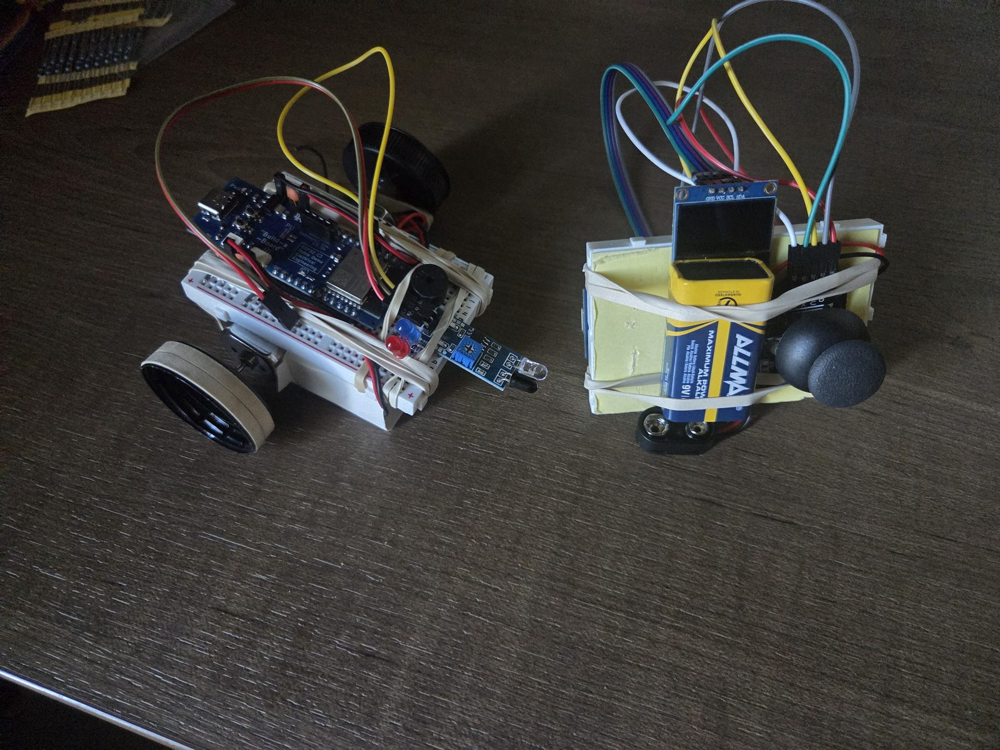
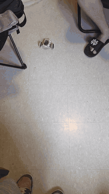

# esp32-rc-car

Two-wheel-drive RC car and handheld controller built on ESP32-C3 boards, linked over ESP-NOW with telemetry sent back to the controller.

 

## Overview

| | Car (`MotorController/`) | Controller (`Transmitter/`) |
|---|---|---|
| Inputs | ESP-NOW commands, IR obstacle sensor | Analog joystick (X/Y + button) |
| Outputs | Two DC motors through a quad half-H driver, red/blue LEDs, passive buzzer | 128×32 SSD1306 OLED (I²C) |
| Sends | Telemetry every 1 s | Joystick state every ~5 ms |

**Link (ESP-NOW, unencrypted, peer-to-peer by MAC address):**

```
controller → car   DataPacket      { int x; int y; bool sysOn; }
car → controller   TelemetryPacket { float RSSI; bool obstacle; }
```

RSSI is read from the receive metadata of the last command packet. The controller shows RSSI and an obstacle warning on the OLED, refreshed every 300 ms.

**Drive logic:** the 12-bit joystick reading is split into 8 directions plus a center deadzone (below 400 / above 3700). Straight lines run both motors at full PWM; diagonals slow the inner wheel to 200/255 for an arc; pure left/right drops it to 50/255 for a tight turn.

**Lights and siren:** toggled with the joystick button. LEDs alternate every 75 ms and the buzzer switches between 900 Hz and 700 Hz every 450 ms, all timed with `millis()` so motor control and ESP-NOW callbacks are never blocked.

## Hardware

Breadboarded prototype powered by a 9 V battery. Schematics:

- [Car](hardware/car-schematic.jpg): ESP32-C3, H-bridge, two motors, IR sensor, LEDs, buzzer
- [Controller](hardware/controller-schematic.jpg): ESP32-C3, joystick, OLED

## Building

Arduino IDE with the ESP32 Arduino core 3.x. The controller also needs the **Adafruit SSD1306** and **Adafruit GFX** libraries.

Each sketch folder includes `pins_arduino.h`, the pin map for the ESP32-C3 board used here.

Before flashing, set the peer MAC addresses:

1. Flash the car and open the serial monitor (9600 baud). It prints `Receiver MAC: ...`.
2. Put that address in `receiverMAC[]` in `Transmitter/Transmitter.ino`.
3. Put the controller's MAC (from `WiFi.macAddress()`) in `transmitterMAC[]` in `MotorController/MotorController.ino`.
